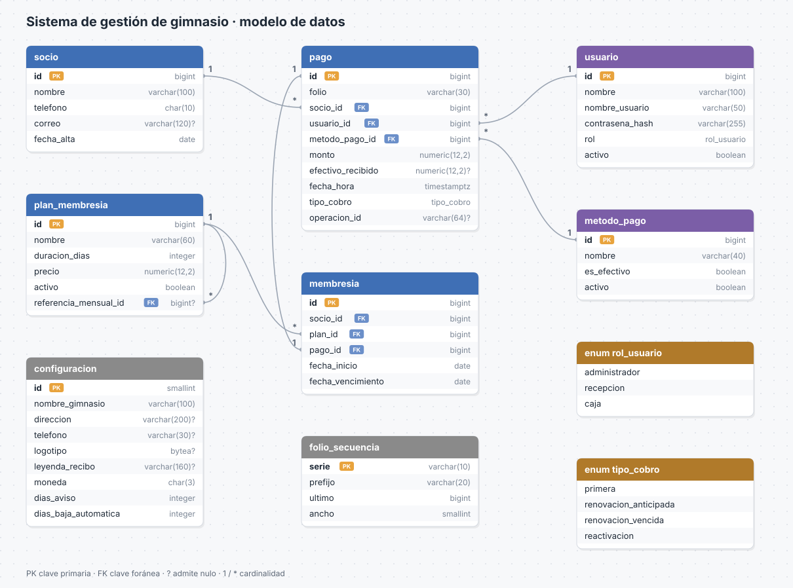

# Modelo de datos

Base de datos PostgreSQL 16. La fuente del modelo es [`modelo-de-datos.dbml`](modelo-de-datos.dbml), que puede abrirse en [dbdiagram.io](https://dbdiagram.io). El [diagrama](#diagrama) se genera a partir de la base real (ver [Cómo se genera el diagrama](#cómo-se-genera-el-diagrama)). Este documento explica las decisiones que el DBML no alcanza a mostrar.

## Alcance

El sistema administra **socios, planes de membresía, métodos de pago, usuarios y el cobro de membresías**, con su configuración y su numeración de folios. Productos, ventas de mostrador e inventario quedaron fuera del alcance del proyecto: la migración `V5__alcance_proyecto.sql` quitó sus tablas (`producto`, `categoria_producto`, `venta`, `detalle_venta`, `movimiento_inventario`, `motivo_movimiento`) y el tipo `tipo_movimiento`. Ningún caso de uso las había llenado, así que no se perdieron datos.

## Esquema relacional

Notación: **negrita** = clave primaria; *cursiva* = clave foránea.

- CONFIGURACION (**id**, nombre_gimnasio, direccion, telefono, logotipo, leyenda_recibo, moneda, dias_aviso, dias_baja_automatica)
- FOLIO_SECUENCIA (**serie**, prefijo, ultimo, ancho)
- USUARIO (**id**, nombre, nombre_usuario, contrasena_hash, rol, activo)
- PLAN_MEMBRESIA (**id**, nombre, duracion_dias, precio, activo, *referencia_mensual_id*)
- METODO_PAGO (**id**, nombre, es_efectivo, activo)
- SOCIO (**id**, nombre, telefono, correo, fecha_alta)
- PAGO (**id**, folio, *socio_id*, *usuario_id*, *metodo_pago_id*, monto, efectivo_recibido, fecha_hora, tipo_cobro, operacion_id)
- MEMBRESIA (**id**, *socio_id*, *plan_id*, *pago_id*, fecha_inicio, fecha_vencimiento)

### Claves foráneas

| Relación | Atributos | Referencia | Cardinalidad |
|---|---|---|---|
| PAGO | socio_id | SOCIO(id) | un socio tiene muchos pagos |
| PAGO | usuario_id | USUARIO(id) | un usuario registra muchos pagos |
| PAGO | metodo_pago_id | METODO_PAGO(id) | un método se usa en muchos pagos |
| MEMBRESIA | plan_id | PLAN_MEMBRESIA(id) | un plan está en muchas membresías |
| MEMBRESIA | (pago_id, socio_id) | PAGO(id, socio_id) | un pago genera exactamente una membresía (1:1) |
| PLAN_MEMBRESIA | referencia_mensual_id | PLAN_MEMBRESIA(id) | un plan mensual es referencia de muchos planes (opcional) |

`MEMBRESIA.socio_id` no apunta directo a SOCIO: llega por la clave compuesta hacia PAGO, que obliga a que la membresía sea del mismo socio que pagó. Ninguna clave foránea borra en cascada: un socio, plan, método o usuario con cobros no se puede borrar (la base lo rechaza y los casos de uso lo explican antes).

### Claves candidatas

| Relación | Clave alterna |
|---|---|
| USUARIO | lower(nombre_usuario) |
| PLAN_MEMBRESIA, METODO_PAGO | lower(nombre) |
| SOCIO | lower(correo), solo entre los que tienen correo |
| PAGO | folio; operacion_id |
| MEMBRESIA | pago_id |

PAGO también declara `(id, socio_id)` como único, aunque `id` ya lo es, solo para que MEMBRESIA pueda referenciar el par.

### Restricciones de integridad

| Tipo | Restricción |
|---|---|
| Dominio | `telefono` de SOCIO: 10 dígitos; `duracion_dias` de 1 a 730; `precio` de PLAN_MEMBRESIA `> 0`; `monto >= 0`; `dias_aviso` de 1 a 60; `dias_baja_automatica` de 1 a 365; `prefijo` de FOLIO_SECUENCIA de 1 a 8 mayúsculas, números o guiones; `rol` y `tipo_cobro` son tipos enumerados |
| Tupla | `fecha_vencimiento > fecha_inicio`; `efectivo_recibido >= monto`; un plan no puede ser su propia referencia mensual |
| Relación | CONFIGURACION tiene una sola tupla (`id = 1`) |
| Operación | `pago` y `membresia` no admiten `DELETE`: los triggers `trg_pago_sin_borrado` y `trg_membresia_sin_borrado` lo rechazan (V6) |

### Normalización

Las relaciones están en tercera forma normal: cada atributo no clave depende solo de la clave completa. `PAGO.monto` no es redundancia: guarda el precio del plan en el momento del cobro, que puede cambiar después en el catálogo. `PAGO.tipo_cobro` tampoco: es lo que fue el cobro en su momento, aunque después cambie el plazo de baja.

## Programación en PostgreSQL

La migración `V6__funciones_y_procedimientos.sql` (copia de `sql/04_funciones.sql` y `sql/05_procedimientos.sql`) agrega:

| Objeto | Tipo | Qué hace |
|---|---|---|
| `fn_fecha_vencimiento(inicio, plan)` | función | inicio + duración del plan |
| `fn_estado_socio(socio, fecha)` | función | SIN_MEMBRESIA, VIGENTE, POR_VENCER, VENCIDA o BAJA según el último vencimiento y la configuración |
| `fn_formatear_folio(prefijo, número, ancho)` | función | `GYM-0007`; un número más largo no se corta |
| `fn_impedir_borrado()` | función de trigger | rechaza el `DELETE` en `pago` y `membresia` |
| `sp_registrar_cobro(...)` | procedimiento | registra un cobro completo: valida, decide el tipo y el inicio, toma el folio e inserta el pago y su membresía |

Los scripts del proyecto, su orden y la matriz de evidencias están en [`sql/README.md`](../sql/README.md); el diccionario de datos, en [diccionario-de-datos.md](diccionario-de-datos.md).

## Diagrama



`configuracion` y `folio_secuencia` no se relacionan con otras tablas: las consulta el proceso de cobro.

### Cómo se genera el diagrama

```bash
scripts/docs/generar-diagrama.sh
```

Levanta un PostgreSQL 16 temporal en Docker, aplica las migraciones en orden, lee tablas, columnas, claves, relaciones y tipos enumerados del catálogo de PostgreSQL (`scripts/docs/esquema.sql`) y los dibuja (`scripts/docs/diagrama.py`). Así el diagrama corresponde siempre con los scripts. La posición de cada tabla está en `diagrama.py`.

## Convenciones

- **Nombres** en español, en singular y en `snake_case`.
- **Claves primarias** `bigint` generadas por la base (`GENERATED ALWAYS AS IDENTITY`).
- **Importes** en `numeric(12,2)`, nunca en `float`. La moneda es una sola para todo el sistema y vive en `configuracion`.
- **Fechas**: `date` para vigencias y altas; `timestamptz` para los cobros.
- **Catálogos** (`plan_membresia`, `metodo_pago`, `usuario`) se desactivan con `activo = false` para conservar el historial; solo se borra lo que nunca se usó (un plan sin membresías ni planes que lo tomen como referencia, un método de pago o un usuario sin cobros).
- **Unicidad sin mayúsculas** en `usuario.nombre_usuario`, `socio.correo`, `plan_membresia.nombre` y `metodo_pago.nombre`: se indexa `lower(columna)`.

## Lo que no se guarda

El **estado del socio** (Sin membresía, Vigente, Por vencer, Vencida, Baja) y sus **bajas** se calculan a partir de sus membresías, de `dias_aviso` y de `dias_baja_automatica`. Guardarlos obligaría a mantenerlos al día con un proceso programado, y cambiar `dias_baja_automatica` no recalcularía el pasado.

## Tipos enumerados

| Tipo | Valores |
|---|---|
| `rol_usuario` | `administrador`, `recepcion`, `caja` |
| `tipo_cobro` | `primera`, `renovacion_anticipada`, `renovacion_vencida`, `reactivacion` |

## Configuración

### `configuracion`

Una sola fila (`CHECK (id = 1)`) con los parámetros del gimnasio.

| Columna | Tipo | Reglas |
|---|---|---|
| `id` | `smallint` | PK, siempre 1 |
| `nombre_gimnasio` | `varchar(100)` | obligatorio |
| `direccion` | `varchar(200)` | |
| `telefono` | `varchar(30)` | |
| `logotipo` | `bytea` | PNG o JPG; se muestra en el acceso, el menú y los recibos |
| `leyenda_recibo` | `varchar(160)` | pie de los recibos |
| `moneda` | `char(3)` | obligatorio, `MXN` por defecto; no se cambia si ya hay cobros |
| `dias_aviso` | `integer` | obligatorio, 7 por defecto, de 1 a 60 |
| `dias_baja_automatica` | `integer` | obligatorio, 30 por defecto, de 1 a 365; cambiarlo recalcula las bajas anteriores |

### `folio_secuencia`

Un contador por serie de folios. Solo existe la serie `COBRO`.

| Columna | Tipo | Reglas |
|---|---|---|
| `serie` | `varchar(10)` | PK: `COBRO` |
| `prefijo` | `varchar(20)` | obligatorio, de 1 a 8 letras mayúsculas, números o guiones, por ejemplo `GYM-` |
| `ultimo` | `bigint` | último número entregado, 0 al inicio |
| `ancho` | `smallint` | dígitos con ceros a la izquierda, 4 por defecto; un número más largo se escribe completo, sin cortarse |

El siguiente folio se toma con `UPDATE folio_secuencia SET ultimo = ultimo + 1 WHERE serie = 'COBRO' RETURNING ...`, dentro de la misma transacción del cobro. Así dos cajas nunca reciben el mismo número. Nunca se calcula con `MAX(folio) + 1`.

## Usuarios

### `usuario`

| Columna | Tipo | Reglas |
|---|---|---|
| `id` | `bigint` | PK |
| `nombre` | `varchar(100)` | obligatorio |
| `nombre_usuario` | `varchar(50)` | obligatorio, único y buscado sin distinguir mayúsculas; con él se entra |
| `contrasena_hash` | `varchar(255)` | obligatorio; hash Argon2id, nunca la contraseña |
| `rol` | `rol_usuario` | obligatorio |
| `activo` | `boolean` | `true` por defecto; un usuario inactivo no entra, pero sus cobros se conservan |

## Catálogos

| Tabla | Columnas propias | Reglas |
|---|---|---|
| `plan_membresia` | `nombre varchar(60)`, `duracion_dias integer`, `precio numeric(12,2)`, `referencia_mensual_id bigint` | nombre único sin distinguir mayúsculas; `duracion_dias` de 1 a 730; `precio > 0`; `referencia_mensual_id` es FK opcional a otro plan (no a sí mismo), el de 30 días contra el que se calcula el ahorro. Los descuentos son planes propios, por ejemplo Estudiante |
| `metodo_pago` | `nombre varchar(40)`, `es_efectivo boolean` | nombre único sin distinguir mayúsculas. Con `es_efectivo` se pide lo recibido y se calcula el cambio |

Las dos tienen `id bigint` como PK y `activo boolean` (`true` por defecto).

## Datos iniciales

La migración `V2__configuracion_inicial.sql` deja la base lista para usarse; el Administrador los cambia después.

| Tabla | Datos |
|---|---|
| `configuracion` | nombre «Mi gimnasio», `MXN`, 7 días de aviso, 30 de plazo de baja |
| `folio_secuencia` | serie `COBRO`, prefijo `GYM-`, ancho 4 |
| `metodo_pago` | Efectivo (`es_efectivo`), Tarjeta, Transferencia |

## Socios y membresías

### `socio`

| Columna | Tipo | Reglas |
|---|---|---|
| `id` | `bigint` | PK |
| `nombre` | `varchar(100)` | obligatorio |
| `telefono` | `char(10)` | obligatorio, `CHECK (telefono ~ '^[0-9]{10}$')` |
| `correo` | `varchar(120)` | opcional; único sin distinguir mayúsculas entre los que lo tienen |
| `fecha_alta` | `date` | obligatoria |

Índices: `UNIQUE (lower(correo)) WHERE correo IS NOT NULL`, búsqueda parcial por `nombre` con GIN y `pg_trgm`, y `telefono`.

### `pago`

Cobro de una membresía.

| Columna | Tipo | Reglas |
|---|---|---|
| `id` | `bigint` | PK |
| `folio` | `varchar(30)` | obligatorio, único; texto ya formado, por ejemplo `GYM-0001` |
| `socio_id` | `bigint` | FK a `socio` |
| `usuario_id` | `bigint` | FK a `usuario`: quién atendió |
| `metodo_pago_id` | `bigint` | FK a `metodo_pago` |
| `monto` | `numeric(12,2)` | obligatorio, `>= 0`; precio del plan en ese momento |
| `efectivo_recibido` | `numeric(12,2)` | solo en efectivo, `>= monto`; el cambio es `efectivo_recibido - monto` |
| `fecha_hora` | `timestamptz` | `now()` por defecto |
| `tipo_cobro` | `tipo_cobro` | obligatorio: `primera`, `renovacion_anticipada`, `renovacion_vencida` o `reactivacion`; lo que fue el cobro en su momento |
| `operacion_id` | `varchar(64)` | único; lo genera la UI al abrir el formulario para que un doble envío no cobre dos veces |

Índices: `UNIQUE (id, socio_id)` para la clave compuesta de `membresia`, `(socio_id, fecha_hora)` para el historial del socio y `fecha_hora` para el resumen del día.

### `membresia`

Un periodo pagado. Es historial: se crea al cobrar y no se modifica.

| Columna | Tipo | Reglas |
|---|---|---|
| `id` | `bigint` | PK |
| `socio_id` | `bigint` | obligatorio |
| `plan_id` | `bigint` | FK a `plan_membresia` |
| `pago_id` | `bigint` | obligatorio, único: un pago genera una membresía |
| `fecha_inicio` | `date` | obligatoria |
| `fecha_vencimiento` | `date` | obligatoria, `> fecha_inicio` |

La clave foránea compuesta `(pago_id, socio_id) → pago (id, socio_id)` garantiza que la membresía pertenezca al mismo socio que hizo el pago.

La membresía vigente de un socio es la de `fecha_vencimiento` más reciente; el índice `(socio_id, fecha_vencimiento)` la encuentra sin recorrer el historial. Al cobrar se bloquea la fila del socio con `SELECT ... FOR UPDATE`, para que dos cobros simultáneos no calculen la misma renovación.
